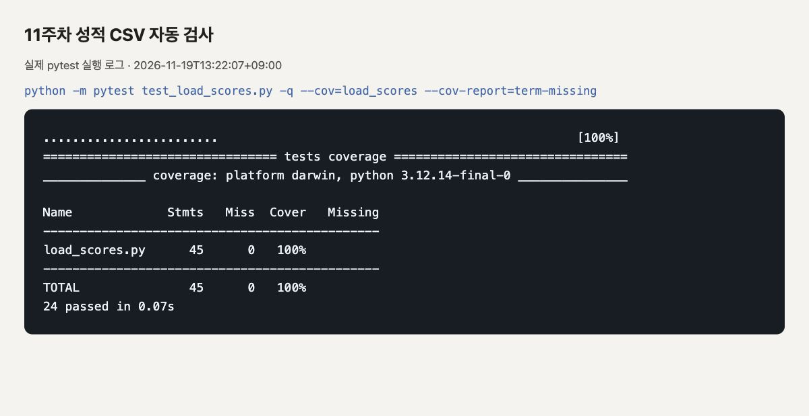

# 성적 CSV 자동 검사

## ① 무엇을 하나요 (What)

성적 CSV에서 0~100점의 유효한 정수 점수를 읽고, 제외한 행의 번호·내용·이유를 돌려주는 프로그램입니다.

## ② 왜 만들었나요 (Why)

11주차 실습에서 출력 내용을 눈으로만 확인하던 성적 CSV 검사를 자동 테스트로 바꾸기 위해 만들었습니다.
정상·예외·경계값의 기대 결과를 명세로 정하고, AI에게 코드를 줬을 때와 명세를 줬을 때 생성되는 테스트의 차이도 확인합니다.

## ③ 어떻게 쓰나요 (How)

Python 3.10 이상이 필요하며 Python 3.12.14에서 확인했습니다.
저장소를 내려받은 뒤 다음 명령을 실행합니다.

```bash
git clone https://github.com/Kangin-koreatech/ai-programming-week11.git
cd ai-programming-week11
python3 -m venv .venv
source .venv/bin/activate
python -m pip install pytest==9.2.0 pytest-cov==7.1.0
python load_scores.py scores.csv
```

Windows에서는 가상 환경 활성화 명령을 `.venv\Scripts\activate`로 바꿉니다.
프로그램의 실행 예시는 다음과 같습니다.

```text
읽은 줄 : 5개
  김하나 88
  최,네번 77
  김하나 91
  윤보람 64
  서한별 95
건너뛴 줄 : 5개
```

반환값은 `(kept, skipped)`이며 `skipped`는 `(CSV 행 번호, 필드를 쉼표로 다시 연결한 내용, 이유)`의 목록입니다.
동명이인은 모두 보존하고, 빈 행은 기록 없이 건너뜁니다.
헤더의 첫 행은 건너뛰며 헤더 이름 자체를 검증하는 기능은 없습니다.
기존 네 상황의 출력을 직접 살펴보려면 `python check.py load_scores`를 실행합니다.
이 도구는 결과를 출력하며 자동 합격 판정은 하지 않습니다.

## ④ 어떻게 테스트하나요

```bash
python -m pytest test_load_scores.py
python -m pytest test_load_scores.py --cov=load_scores --cov-report=term-missing
```

기준 테스트는 파일 이름을 지정해 실행합니다. AI 생성 원문은 비교 실험용으로 따로 실행하며, 실패 결과도 그대로 보존했습니다.
명세를 기준으로 만든 15개 테스트 함수가 매개변수 조합을 포함해 24회 실행되며 모두 통과합니다.
초기 11회 검사에서 커버리지는 60%였고, 열 개수 오류·비정수·빈 이름·빈 점수 및 명령줄 실행 검사를 추가한 뒤 문장 커버리지가 100%였습니다.
커버리지 100%가 모든 입력에서의 정확성을 보장하는 것은 아닙니다.

실제 pytest 실행 로그를 표시한 화면입니다.



AI 생성 원문은 다음 명령으로 각각 실행합니다.
비교 실험을 위해 받은 테스트의 기대값을 수정하지 않았습니다.

```bash
python -m pytest test_ai_A.py --cov=load_scores --cov-report=term-missing
python -m pytest test_ai_B.py --cov=load_scores --cov-report=term-missing
python -m pytest test_ai_bug.py
```

| 구분 | 테스트 함수 | 실행 결과 | load_scores.py 문장 커버리지 |
| --- | ---: | --- | ---: |
| 명세 기준 검사 | 15개 | 24 통과 | 100% |
| A: 전체 코드를 제공 | 9개 | 24 통과 | 80% |
| B: 여섯 칸 명세만 제공 | 8개 | 21 통과·5 실패 | 80% |
| 함정: 고장난 find_max 제공 | 7개 | 10 통과·1 실패 | 해당 없음 |

B의 실패는 따옴표 앞 공백의 처리, 공백뿐인 행의 의미, `원본줄`에 CSV 따옴표가 남아야 하는지에 대한 해석 차이에서 나왔습니다.
배포 코드의 `원본줄`은 파일의 원문 그대로가 아니라 파싱한 필드를 다시 연결한 문자열입니다.
따라서 실패를 무조건 구현 오류로 판단하지 않고, 명세가 더 구체적이어야 하는 지점으로 기록했습니다.
함정 테스트는 마지막 원소가 최댓값인 `[10, 20, 30, 99]`의 정답을 99로 두었고 실제 반환 30과 달라 실패했습니다.
85를 정답으로 고정하는 테스트는 생성되지 않았습니다.
함정 원문에는 제공된 함수를 복사한 구현도 포함되어 있어, 운영 코드의 회귀 검사와는 구분해야 합니다.

## ⑤ 파일 구성

| 파일 | 하는 일 |
| --- | --- |
| `load_scores.py` | 배포된 성적 CSV 로더와 명령줄 실행부 |
| `scores.csv`, `empty.csv`, `weird.csv` | 배포된 정상·빈 결과·이상 데이터 입력 |
| `test_load_scores.py` | 명세 기준 정상·예외·경계값 및 추가 검사 |
| `test_ai_A.py`, `test_ai_B.py` | 같은 모델의 독립된 새 대화에서 받은 테스트 원문 |
| `test_ai_bug.py` | 고장난 find_max를 제공한 함정 실험의 테스트 원문 |
| `bug3_logic.py` | 수업에서 제공한 고장난 함수 예제 |
| `check.py` | 10주차의 네 상황 출력 확인 도구 |
| `prompts.txt` | 배포된 실험 프롬프트 |
| `pytest_result.jpg` | 실제 pytest 실행 출력 화면 |
| `.gitignore` | 가상 환경·캐시·커버리지 임시 파일 제외 |
| `LICENSE` | MIT 라이선스 |

## ⑥ 만든 사람 · AI를 어디에 썼는지

- 만든 사람: 김강인
- AI를 쓴 곳: Codex로 명세 기반 테스트·README 초안·워크시트를 작성하고 명령을 실행했습니다. A·B·함정 테스트는 Gemini 앱의 Hydrogen 표시 모델, 같은 기본 채팅 설정, 각기 새 대화에서 생성했습니다.
- 판단 기준: 11주차 배포 명세의 정수 점수·동명이인 보존 정책으로 기대값을 정하고, AI 테스트 실패는 수정해서 숨기지 않고 실제 결과로 기록했습니다.
- 수업 배포 자료: 한국기술교육대학교 AI 협업 프로그래밍 11주차 실습 자료. `load_scores.py`, `bug3_logic.py` 및 배포 CSV는 원본을 유지했습니다.

## 라이선스

MIT License. `LICENSE` 파일을 참고하세요.
